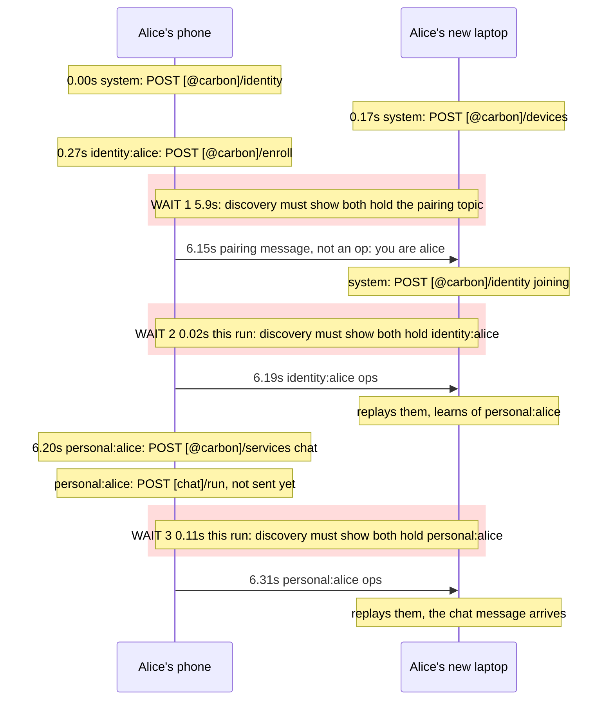

# How CarbonDB uses p2panda

Status: draft — working notes for the agenda topic "p2panda takes seconds to minutes to deliver a channel's new ops over a relay"; versions p2panda 0.8.1, p2panda-net 0.8.1.

## In one paragraph

Two devices exchange a channel's ops only over a sync session for that channel's p2panda space, and p2panda opens that session only after its own discovery has told both devices that the other holds the same space. Knowing where a device is (its address, its relay) is not enough: the devices in the milestone test know each other's addresses from enrollment and talk over discovery within milliseconds, yet a channel's ops wait until a discovery exchange happens to compare that channel. Discovery runs on a timer that backs off to 30 seconds, so a channel a device has just joined can wait anywhere from milliseconds to over a minute for its first session. CarbonDB knows which devices hold each channel, but p2panda 0.8.1 offers no public way to tell it so.

## p2panda's pieces and their lifecycle

| Piece | What it is | Starts | Ends |
|---|---|---|---|
| Node | One signing key, its SQLite store, its network stack | `spawn` | No shutdown call in 0.8.1 |
| Address book | Per node: every known node's id, its addresses (signed, or trusted from a side channel), and which topics it holds | With the node | With the node |
| Discovery | Random walks over the address book; each step is a session with one node that swaps addresses and compares topics privately, revealing only topics both hold | With the node; walkers restart when this node adds a topic | With the node |
| Space | An encrypted topic with a member list (members are signing keys) | Creator: `create_space`; others: `space(id)` then wait to be added | `close` |
| Gossip overlay | Per topic: the neighbours this node exchanges with, seeded only from address-book nodes known to hold the topic | When the node subscribes to the topic, and again when the address book learns a new holder | When the node leaves the topic |
| Sync session | Per topic and per neighbour pair: catches up on missing ops, then stays open and carries new ops live | When two nodes become gossip neighbours on the topic | When either leaves the overlay, or the connection fails (retried after 5s) |
| Ephemeral stream | An unlogged topic for short exchanges | `ephemeral_stream` | When dropped |

## CarbonDB on p2panda

| CarbonDB | p2panda | Where | Gap |
|---|---|---|---|
| An identity on this device | One node, signing with the identity's device key | `crates/core/src/nodes/mod.rs:1` | Nodes cannot be shut down (agenda: "A stopped node is shut down") |
| A channel | One space; its id is the channel id | `crates/core/src/nodes/spaces.rs:117`, `:161` | — |
| The channel log's rows | Messages published to the space, acked once logged | `crates/core/src/nodes/publish.rs`, `spaces.rs` | — |
| The devices that hold a channel | The space's members | `crates/core/src/nodes/members.rs` | Members are keys; the address book's topic list is filled only by discovery, so membership never seeds the overlay |
| Enrolling a device | A pairing ephemeral stream; the existing device adds the new device's address as a bootstrap, then adds it to every space | `crates/core/src/nodes/pairing.rs:334` | Gives the address, not which spaces the device holds |
| A device starting to hold a channel | `space(id)`, then wait to be joined | `crates/core/src/nodes/spaces.rs:161` | Its first session waits on a discovery exchange |
| Relays, bootstraps, mDNS | Node builder options; CarbonDB sets its own network id | `crates/core/src/nodes/mod.rs:196`–`206` | Back-off is fixed; only walker count and restart probability are configurable |
| Peers in a shared channel outside the identity | Space members | — | They have no list of the identity's devices (agenda: "Peers learn an identity's devices from a published read-only identity channel") |

## What the logged run showed

A passing run of the relay milestone, 2026-11-18, with p2panda's debug logs:

| Configuration | Discovery between the devices | identity:alice's session | personal:alice's session | Chat message reaches device 2 |
|---|---|---|---|---|
| Relay only | Working from the start | After one exchange | After a later exchange, 0.15s after the message was published | At once when the session opened |
| Relay and bootstrap | Working from the start | After one exchange (3s) | After a later exchange, 4.1s after the message was published | At once when the session opened |

Each exchange compared the topics both devices held at that moment: the first found one shared topic (identity:alice), a later one found two (adding personal:alice, which device 2 joins only once it has identity:alice's ops). Failing runs are the same wait with the back-off grown.

The bootstrap node in the test bootstraps nothing: it runs with p2panda's default network id while CarbonDB nodes use their own, so every discovery session with it fails ("peer doesn't support any known protocol").

## Where the time goes: one passing run

Alice's phone founds alice. Her laptop is a new device: before enrolling it holds no identity and no channel. Each op is prefixed with the handle it is called on: `system` is the device's own local channel, `identity:alice` alice's identity channel, `personal:alice` her personal channel. The red bands are the waits; nothing else takes measurable time. Times are from the logged relay-only run, in seconds after founding.

Each wait is the same wait: a channel's ops flow between two nodes only once a discovery session has recorded, in each node's address book, that the other holds that channel. Discovery runs on a random walk whose pauses grow to 30s when it finds nothing new, so any of the three waits can take from milliseconds to over a minute; in this run the last two were short, in a failing run one of them is long. During waits 2 and 3 the laptop already knows the phone holds the channel, since `identity:alice` lists alice's devices, but has no way to tell its own p2panda node.

## Telling a node who holds a space

No new message between the devices is needed: by the time the laptop starts holding personal:alice it has already received everything it needs, in identity:alice's ops. [identity] lists alice's devices by device key, and a device key is its node id (`p2panda-0.8.1/src/node.rs:736`); identity:alice points to personal:alice, and every device of alice holds alice's channels. What is missing is local: the laptop's CarbonDB cannot hand that to its own node's address book. So the information piggybacks on messages already sent; the gap is one call, from CarbonDB to its own p2panda node.

A new message would add nothing: on a channel both nodes already share (as identity:alice) it would arrive, but would carry what that channel's ops already carry; on a CarbonDB topic of its own it would wait on the same discovery, since every p2panda topic, ephemeral or logged, reaches another node only through gossip seeded by discovery.

## What a check-in does: the spike

`spikes/p2panda-check-in/` patches p2panda-net 0.8.1 so a node that starts holding a topic runs discovery at once with every node it already knows how to reach, and measures a new device's wait for a first space and a chained second one, with and without it. With the check-in, both waits are 0.02–0.07s on every run; as released they are 1–4s on fresh or idle nodes and up to 13s with a bootstrap node on another network, as the milestone test has. No call from CarbonDB is needed: the nodes already know each other, and the existing discovery session, run at the right moment, supplies "this node holds this space". Its README has the numbers and the patch.

## The missing call

An address-book entry is a node id plus its addresses: what a bootstrap server would hold. p2panda already lets CarbonDB add one (`insert_bootstrap`), and enrolling does. What is missing is the second half: that this node holds this space. Discovery writes it today; p2panda-net has a call that writes it directly (`AddressBook::add_topic`), but p2panda 0.8.1 keeps the address book private to its node, so it cannot be called or tested from CarbonDB.

What writing it would do is read from the code and matches the log: each space's gossip has a healer watching the address book for nodes that hold its topic, and joins them when the set changes (`p2panda-net-0.8.1/src/gossip/actors/healer.rs`); in the run above every "holds" entry was followed by a gossip join within milliseconds. With such a call, the laptop, on starting to hold personal:alice, would record the phone as holding it, since [identity] in identity:alice lists her devices, and join the phone's gossip on that channel at once; the phone, already holding it and knowing the laptop as a member, accepts. One wrinkle: the address book keys topics by a gossip topic p2panda derives from the space id, so the natural upstream call is on the space ("sync with these nodes"), not on the address book.
